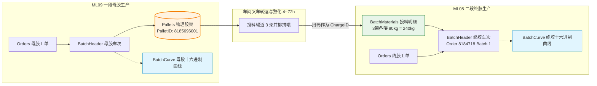
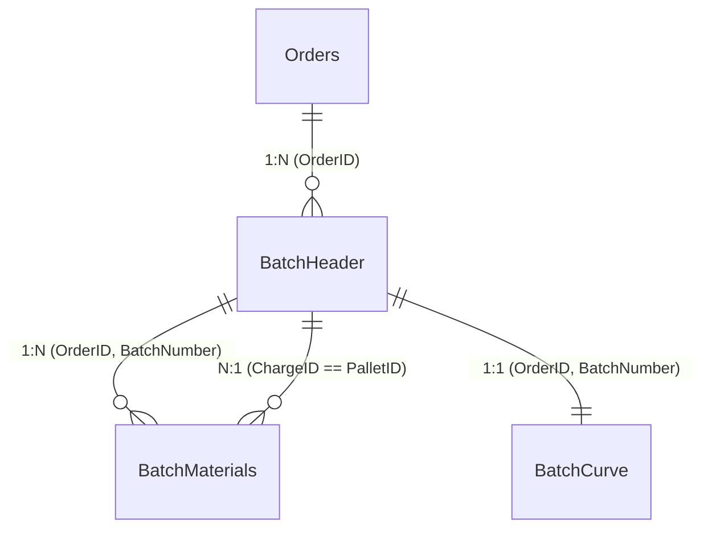

# 🏭 大陆轮胎 SFE 混炼云数据库特征工程与数据打通技术指南 (文档一)

> **文档性质**：AI Agent 自动化执行契约与核心开发规范  
> **适用对象**：具备 Agent 调度能力的编码助手 (Antigravity/Cursor/Claude) 及数据工程师  
> **状态**：生产环境已打通并验证 (AWS RDS SQL Server: `HESFESFEPLANT`)

---

## 🤖 AI Agent 极速操作契约 (Agent Quick-Action Contract)

```yaml
agent_contract:
  python_env: "C:\\Users\\uih83490\\.conda\\envs\\Mooney\\python.exe"
  config_file: "d:\\AntigravityIDE\\Project\\db_config.json"
  target_database: "HESFESFEPLANT"
  core_modules:
    db_client: "d:\\AntigravityIDE\\Project\\db_client.py"
    compound_tracer: "d:\\AntigravityIDE\\Project\\compound_tracer.py"
  physical_invariant: "BatchMaterials.ChargeID == BatchHeader.PalletID"
  sql_syntax_rule: "OrderID 字段为 varchar 类型，SQL 条件中必须包裹单引号，严禁数字裸传"
```

### Agent 单行验证命令 (Zero-File Execution)
```powershell
C:\Users\uih83490\.conda\envs\Mooney\python.exe -c "import compound_tracer; res = compound_tracer.trace_final_mix_to_masterbatch('8184718', 1); print('Matched MB Batches:', len(res['masterbatch_links']))"
```

---

## 一、物理拓扑与业务流动机理

生产现场不可打破的物理事实：
1. **一段母胶（ML09）连续折叠成托**：密炼机排胶后经由胶片冷却线连续折叠在大铁托盘上，**单个托盘（PalletID）装载 4~5 车母胶**（约 1.1~1.4 吨）。
2. **二段终胶（ML08）三架并排拼喂**：投料口并排放置 **3 个不同母胶托盘**，各拉出一根胶条同时裁切投入（每架各提供 80kg，合计提供 **240kg 母胶**）。



> [!IMPORTANT]
> **物理纽带等价定理 (The Equivalence Theorem)**：  
> **`BatchMaterials.ChargeID` (终胶投料批号) $\equiv$ `BatchHeader.PalletID` (母胶产出托盘号)**  
> 这是跨工序定位终胶对应母胶车次的**唯一确定性主键**。

---

## 二、数据表结构与字段映射规范



| 数据表名 | 核心职责 | Agent 必查关键字段 | 数据类型 | 说明 |
| :--- | :--- | :--- | :--- | :--- |
| `Orders` | 工单定义主表 | `OrderID` | `varchar(20)` | 工单唯一编号 (**必须加单引号**) |
| | | `CompoundCode` | `varchar(50)` | 胶料品号 (如 `992251576000`) |
| | | `CompoundName` | `varchar(100)`| 胶料全名 (如 `FMW-T15760W5-- 01 005`) |
| `BatchHeader` | 车次元数据表 | `OrderID` | `varchar(20)` | 关联工单 |
| | | `BatchNumber` | `int` | 车次编号 (1, 2, 3...) |
| | | `PalletID` | `varchar(30)` | 产出胶架托盘条码 (**关联关键字段**) |
| | | `BatchWeight` | `float` | 排胶称重重量 (kg) |
| | | `EquipmentID` | `varchar(20)` | 生产机台号 (如 `92-1080` 对应 ML08) |
| | | `BatchStartTime` | `datetime` | 车次混炼开始时间 |
| `BatchMaterials`| 车次投料明细表 | `SequenceNumber` | `int` | 步序，**`10` 固定为母胶投入步序** |
| | | `ChargeID` | `varchar(30)` | 投料扫码胶架条码 (**等价母胶 PalletID**) |
| | | `MaterialName` | `varchar(100)`| 原料品名 (如 `M1-T15760----`) |
| | | `ConsumedWeightFromLot` | `float` | 该托盘投入累计消耗重量 (kg) |
| `BatchCurve` | 混炼过程曲线表 | `Curve1` | `varchar(max)`| 混炼温度曲线 (16-bit 十六进制编码) |
| | | `Curve2` | `varchar(max)`| 电机实时功率曲线 (16-bit 十六进制编码) |
| | | `Curve3` | `varchar(max)`| 上顶栓压栓位移/压力曲线 |
| | | `Curve6` | `varchar(max)`| 转子转速曲线 (rpm) |

---

## 三、核心直连 SQL 模板 (Deterministic Query)

在任何 SQL 客户端或 Python `db_client.query_df()` 中执行：

```sql
SELECT 
    -- 1. 终胶端信息 (Final Mix)
    fm_mat.OrderID               AS [FM_OrderID],
    fm_mat.BatchNumber           AS [FM_BatchNumber],
    fm_mat.MaterialName          AS [MB_MaterialName],
    fm_mat.ConsumedWeightFromLot AS [ConsumedWeight_kg],
    
    -- 2. 物理关联纽带 (胶架条码)
    fm_mat.ChargeID              AS [Pallet_Barcode],
    
    -- 3. 关联出的母胶端信息 (Masterbatch)
    mb_head.OrderID              AS [MB_OrderID],
    mb_head.BatchNumber          AS [MB_BatchNumber],
    mb_head.EquipmentID          AS [MB_EquipmentID],
    mb_head.BatchStartTime       AS [MB_BatchStartTime],
    mb_head.BatchWeight          AS [MB_BatchWeight_kg]
FROM BatchMaterials fm_mat
INNER JOIN BatchHeader mb_head 
    ON fm_mat.ChargeID = mb_head.PalletID
WHERE fm_mat.OrderID = '8184718'   -- 目标终胶工单号 (必须包含单引号)
  AND fm_mat.BatchNumber = 1        -- 目标终胶车次号
  AND fm_mat.SequenceNumber = 10    -- 固定步序 10 (母胶投入)
ORDER BY mb_head.OrderID, mb_head.BatchNumber;
```

---

## 四、十六进制曲线解码算法规范

`BatchCurve` 表中的曲线使用 16-bit 无符号整数的 4 位十六进制紧凑编码：

```python
def decode_curve_hex(hex_str: str) -> list[int]:
    """
    解码 SFE 十六进制曲线为物理数值序列。
    每个点位占用 4 位十六进制字符，时间步长通常为 0.5s 或 1.0s。
    """
    if not hex_str or not isinstance(hex_str, str):
        return []
    cleaned = hex_str.strip()
    return [int(cleaned[i:i+4], 16) for i in range(0, len(cleaned) - 3, 4)]
```

### 终胶 vs 母胶实测物理特征基线
| 特征通道 | 终胶标准范围 (`8184718-1`) | 母胶标准范围 (`8185696-1`) | 物理动因 |
| :--- | :---: | :---: | :--- |
| **起始温度 (`Curve1`)** | 60 ~ 65 °C | 80 ~ 90 °C | 终胶预冷机腔；母胶前车余温较高 |
| **排胶终温 (`Curve1`)** | 80 ~ 88 °C | 110 ~ 125 °C | 终胶控温防焦烧；母胶高温促进分散 |
| **峰值功率 (`Curve2`)** | 500 ~ 700 kW | 950 ~ 1200 kW | 母胶含纯生胶剪切阻力极大；终胶已软化 |
| **采样点数 (时长)** | 280 ~ 300 点 (约 190s) | 400 ~ 450 点 (约 240s) | 母胶需充分捏炼分散炭黑，耗时更长 |

---

## 五、端到端 Python 调度接口

模块文件：[compound_tracer.py](file:///d:/AntigravityIDE/Project/compound_tracer.py)

```python
from compound_tracer import trace_final_mix_to_masterbatch, get_batch_curves

# 1. 物理链路全匹配 (终胶 -> 全部母胶)
trace_result = trace_final_mix_to_masterbatch(order_id="8184718", batch_number=1)

# 输出结构契约:
# trace_result['final_mix'] -> 终胶车次元数据 dict
# trace_result['charged_materials'] -> 投料托盘列表 list[dict]
# trace_result['masterbatch_links'] -> 匹配出的母胶托盘及车次范围 list[dict]

# 2. 物理混炼曲线提取 (返回 DataFrame)
curve_df = get_batch_curves(order_id="8184718", batch_number=1)
# DataFrame 字段: ['time_step_sec', 'temperature_c', 'power_kw', 'ram_position', 'torque_energy', 'rotor_speed_rpm']
```

---

## 六、自测验证基准 (Ground Truth)

以 `8184718` 第 1 车为例，执行测试应输出以下严格对应的 13 车母胶：

* **托盘 1 (`8181640008`)** ➔ 母胶工单 `8181640`，车次 **36, 37, 38, 39** (机台: 92-1090)
* **托盘 2 (`8181640015`)** ➔ 母胶工单 `8181640`，车次 **64, 65, 66, 67** (机台: 92-1090)
* **托盘 3 (`8185696001`)** ➔ 母胶工单 `8185696`，车次 **1, 2, 3, 4, 5** (机台: 92-1090)
* **累计投入重量**：3 个托盘各出 80kg，合计精准喂入 **240.0 kg** 母胶。
