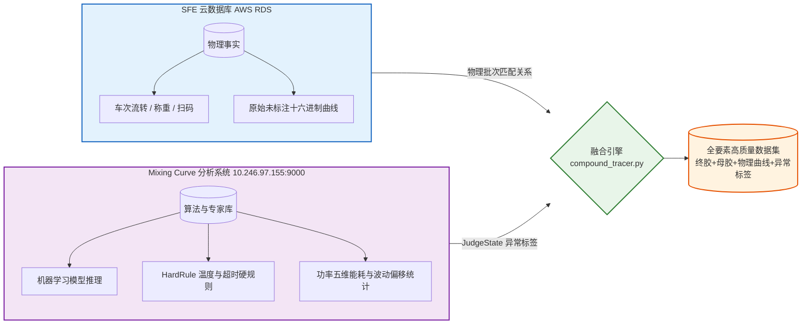

# 📊 大陆轮胎 Mixing Curve 混炼曲线系统异常打通与数据融合技术指南 (文档二)

> **文档性质**：AI Agent 自动化执行契约与核心开发规范  
> **适用对象**：具备 Agent 调度能力的编码助手 (Antigravity/Cursor/Claude) 及数据工程师  
> **状态**：内网 REST API 已打通并完成双链路实测验证 (`http://10.246.97.155:9000`)

---

## 🤖 AI Agent 极速操作契约 (Agent Quick-Action Contract)

```yaml
agent_contract:
  server_endpoint: "http://10.246.97.155:9000"
  protocol: "HTTP RESTful JSON API"
  python_module: "d:\\AntigravityIDE\\Project\\mixing_system_client.py"
  combined_module: "d:\\AntigravityIDE\\Project\\compound_tracer.py"
  normal_criteria: "(JudgeState == 'Normal') and (RamPositionJudgeState in ['Normal', '', None])"
  failure_modes:
    http_404: "前序车次发生粘门(TemperCooling)等硬件异常，导致当前车次采集断流，数据真实缺失"
    peer_records: "接口可能返回多条历史同组比对曲线，必须使用 target OrderID 和 BatchID 进行精确过滤"
```

### Agent 单行验证命令 (Zero-File Execution)
```powershell
C:\Users\uih83490\.conda\envs\Mooney\python.exe -c "import mixing_system_client; print(mixing_system_client.get_batch_anomaly('8184718', 1))"
```

---

## 一、双系统架构分工与融合定位



* **SFE 云数据库 (文档一)**：提供**物理流向骨架**（终胶究竟投了哪几架、哪几车母胶）。
* **Mixing Curve 系统 (文档二)**：提供**质量判定语义**（终胶与母胶各自是正常、首车异常、粘门还是功率异常）。

---

## 二、REST API 接口规范与 JSON 响应契约

### 1. 单车全曲线与判定接口
* **Endpoint**: `GET /api/CurveAnalysisHistory/MixingCurveData`
* **Query Params**:
  * `orderId` (string/int, 必填): 工单号 (如 `"8184718"`)
  * `batchId` (string/int, 必填): 车次号 (如 `1`)
* **Response Schema (JSON)**:
  ```json
  {
    "orderID": "8184718",
    "batchID": "1",
    "allCurveData": [
      {
        "MixID": "4b7727b6-ed61-460c-aac7-7e0165176044",
        "OrderID": "8184718",
        "BatchID": "1",
        "CompName": "992251576000_PV62_005",
        "Mixer": "ML08",
        "ProductTime": "2026-10-21T21:30:56",
        "JudgeState": "FS:Module-Mark",
        "JudgeReason": "类第一车异常",
        "JudgeMode": "Auto",
        "RamPositionJudgeState": "Normal",
        "TemperData": "003E003E003E...", 
        "PowerData": "001D00330048...",
        "RamPositionData": "06870687..."
      }
    ]
  }
  ```

> [!CAUTION]
> **Agent 解析注意项**：`allCurveData` 数组通常包含同组参考历史车次（约 20 条）。Agent 必须通过 `item['OrderID'] == orderId and item['BatchID'] == batchId` 提取当前目标车次。

---

## 三、异常判定状态机与完整枚举字典

### 1. 确定性判定逻辑 (Deterministic Python Logic)
```python
def is_batch_normal(judge_state: str, ram_state: str) -> bool:
    """标准异常裁决函数"""
    is_judge_ok = (judge_state == "Normal")
    is_ram_ok = (ram_state in ("Normal", "", None))
    return is_judge_ok and is_ram_ok
```

### 2. `JudgeState` 字段完整枚举字典
| 状态枚举值 (`JudgeState`) | 中文分类 | 业务/物理动因 | 判决分类 |
| :--- | :--- | :--- | :---: |
| `Normal` | **正常** | 混炼过程曲线完全符合模型基线与工艺硬规则 | ✅ 正常 |
| `FS:Module-Mark` | **类第一车异常** | 呈现批次起始首车的非平稳升温与剪切波动 | ❌ 异常 |
| `MO:Module-Mark` | **模型判定异常** | 曲线形态特征（积分、斜率、拐点）偏离统计基线 | ❌ 异常 |
| `MW:Module-Warning` | **模型预警** | 过程处于临界边缘，标记为轻微/预警异常 | ⚠️ 预警 |
| `EX:Experience-RubberJam` | **卡胶** | 密炼室内物料结团进料卡滞 | ❌ 异常 |
| `EX:Experience-RubberSticking`| **架胶** | 物料在进料口架桥搭接，未能顺利落入密炼室 | ❌ 异常 |
| `EX:Experience-TemperCooling` | **粘门** | 胶料粘挂在卸料底门上，造成排胶延迟与急冷 | ❌ 异常 |
| `HD:BottomTemper` | **下密炼温超** | 下段排胶温度超出安全上限 | ❌ 异常 |
| `HD:TopTemper` | **上密炼温超** | 捏炼阶段温度超出硬规则工艺限制 | ❌ 异常 |
| `HD:TimeOut` | **混炼超时** | 超过额定混炼周期排胶 | ❌ 异常 |
| `Undetermined` | **暂不判定** | 该胶料有效历史样本 < 50 车，缺乏对比基线 | ⏸️ 待定 |

### 3. `RamPositionJudgeState` (压栓状态)
* `Normal` / `空`：上顶栓正常保压下行。
* `偏高`：物料体积过大或卡料阻挡，柱塞未压到位。
* `偏低`：投料量不足或胶料过度塌陷。
* `Abnormal`：位移曲线异常畸变。

### 4. 功率五维偏移监控 (Power Anomalies)
由接口 `/api/SystemOverview/PowerFillerCompOrders` 监控的 5 大统计偏移（$Z\text{-Score} > 4.0$ 时报警）：
1. **`干混段能耗偏移`**：生胶干磨耗能偏差，反映生胶粘度波动。
2. **`油加料段峰值功率偏移`**：注油瞬态峰值畸变，反映吸油阻力异常。
3. **`油加料段能耗偏移`**：注油吸油总功耗偏离。
4. **`湿混段功率波动偏移`**：均化阶段微观分散波动过大。
5. **`湿混段峰值功率偏移`**：湿捏炼剪切峰值负荷超限。

---

## 四、双链路数据融合执行算法 (Agent Step-by-Step Algorithm)

当 Agent 需要获取带有异常状态的混炼全链路数据时，遵循以下确定性算法：

```python
# 伪代码算法 (Deterministic Pseudocode)
def pipeline_trace_with_anomaly(order_id: str, batch_number: int):
    # 步骤 1: 调用 Cloud DB 查询终胶投料的母胶托盘 (ChargeID)
    trace_data = SFE_Cloud_DB.trace_final_mix(order_id, batch_number)
    
    # 步骤 2: 调用 Mixing Curve API 查询终胶本车的异常状态
    fm_anomaly = Mixing_System_API.get_batch_anomaly(order_id, batch_number)
    trace_data['final_mix_anomaly'] = fm_anomaly
    
    # 步骤 3: 遍历每一个匹配到的母胶托盘及车次
    for pallet_group in trace_data['masterbatch_links']:
        mb_order = pallet_group['MB_OrderID']
        mb_start_batch = pallet_group['MB_StartBatch']
        
        # 步骤 4: 查询母胶车次的异常状态
        mb_anomaly = Mixing_System_API.get_batch_anomaly(mb_order, mb_start_batch)
        pallet_group['MB_StartBatch_Anomaly'] = mb_anomaly
        
    return trace_data
```

---

## 五、端到端 Python 调度接口

模块文件：[mixing_system_client.py](file:///d:/AntigravityIDE/Project/mixing_system_client.py) 与 [compound_tracer.py](file:///d:/AntigravityIDE/Project/compound_tracer.py)

```python
import compound_tracer
import mixing_system_client

# 1. 独立单车查询异常与解码曲线
res = mixing_system_client.get_batch_anomaly(order_id="8184718", batch_id=1)
print("是否正常:", res["is_normal"])
print("状态:", res["judge_state"], "| 原因:", res["judge_reason"])
print("温度点数:", len(res["temperature_curve"]), "功率点数:", len(res["power_curve"]))

# 2. 全链路一键联合提取 (终胶 + 关联母胶 + 双方判定)
unified_res = compound_tracer.trace_final_mix_with_anomaly(order_id="8184718", batch_number=1)
print("终胶判定:", unified_res["final_mix_anomaly"])
for mb in unified_res["masterbatch_links"]:
    print(f"母胶工单 {mb['MB_OrderID']}:", mb["MB_StartBatch_Anomaly"])
```

---

## 六、真实性与因果链条验证基准 (Ground Truth)

以终胶 `8184718` 第 1 车对应的 **13 车母胶逐车核验结果** 为准：

| 托盘号 | 母胶车次 | 真实判定结论 | `JudgeState` | `JudgeReason` | 物理规律交叉印证 |
| :---: | :---: | :---: | :--- | :--- | :--- |
| `8181640008` | 车次 36 | ✅ **正常** | `Normal` | `None` | 正常生产稳态 |
| `8181640008` | 车次 37 | ❌ **异常** | `EX:Experience-TemperCooling` | **下密炼粘门，导致下一车数据丢失** | 系统精准报警 |
| `8181640008` | 车次 38 | ⚠️ **丢失** | *HTTP 404* | 数据断流缺失 | **验证了 37 车粘门导致的丢失** |
| `8181640008` | 车次 39 | ✅ **正常** | `Normal` | `None` | 恢复正常排胶 |
| `8181640015` | 车次 64, 65 | ✅ **正常** | `Normal` | `None` | 正常稳态 |
| `8181640015` | 车次 66 | ⚠️ **丢失** | *HTTP 404* | 数据断流缺失 | 偶发通信丢包 |
| `8181640015` | 车次 67 | ✅ **正常** | `Normal` | `None` | 正常稳态 |
| `8185696001` | 车次 1 | ❌ **异常** | `FS:Module-Mark` | **类第一车异常 (功率4维超限)** | 批次首车热机不稳定 |
| `8185696001` | 车次 2~5 | ✅ **正常** | `Normal` | `None` | 第 2 车起热机完成迅速恢复正常 |

> [!TIP]
> **真实工艺结论**：打通双链路后，Agent 不仅能发现终胶 `8184718-1` 自身是首车异常，还能精准穿透发现其喂入的母胶 `8185696-1` 也是首车异常，从而准确定位工艺波动的物理源头！
