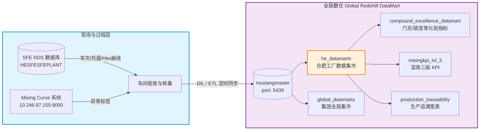

# 🏛️ 大陆轮胎 Global Redshift 数仓化验与追溯数据打通技术指南 (文档三)

> **文档性质**：AI Agent 自动化执行契约与核心开发规范  
> **适用对象**：具备 Agent 调度能力的编码助手 (Antigravity/Cursor/Claude) 及数据工程师  
> **状态**：内网生产环境已打通并验证 (Amazon Redshift: `mustangmaster` @ `5439`)

---

## 🤖 AI Agent 极速操作契约 (Agent Quick-Action Contract)

```yaml
agent_contract:
  python_env: "C:\\Users\\uih83490\\.conda\\envs\\Mooney\\python.exe"
  config_file: "d:\\AntigravityIDE\\Project\\db_config.json"
  target_database: "mustangmaster"
  db_type: "redshift"
  auth_type: "username"
  driver: "redshift_connector"
  core_module: "d:\\AntigravityIDE\\Project\\db_client.py"
  primary_schema: "he_datamarts"
  key_tables:
    lab_testing: "he_datamarts.compound_excellence_datamart"
    mixing_kpi: "he_datamarts.mixingkpi_lvl_3"
    traceability: "he_datamarts.production_traceability"
```

### Agent 单行验证命令 (Zero-File Execution)
```powershell
& "C:\Users\uih83490\.conda\envs\Mooney\python.exe" -c "import db_client; print(db_client.query_redshift_df('SELECT current_user, current_database()'))"
```

---

## 一、系统架构与数据湖仓定位



* **SFE 云数据库 (文档一)**：提供即时高频的车次流水与毫秒级十六进制混炼曲线。
* **Mixing Curve 系统 (文档二)**：提供单车混炼质量判定（`JudgeState` 首车/模型/粘门异常）。
* **Global Redshift 数仓 (文档三)**：提供**最终实验室离线化验指标**（门尼黏度 `MS1+3`、硫化流变 `MD200`、模量 `G'`、损耗因子 `TanD`）及工厂长期追溯宽表，是闭环构建 **“混炼过程特征 $\to$ 终胶化验指标”** 的核心真值源。

---

## 二、连接配置规范 ([db_config.json](file:///d:/AntigravityIDE/Project/db_config.json))

```json
{
  "RedshiftDatamart": {
    "type": "redshift",
    "auth_type": "username",
    "user": "ppm_technique_user_ro",
    "password": "Woaizhongguo123",
    "host": "mustang-global-redshift-datamart-01.cs0z5y6iuviq.eu-central-1.redshift.amazonaws.com",
    "port": 5439,
    "database": "mustangmaster"
  }
}
```

---

## 三、核心 Schema 与数据表结构

合肥工厂数据主要聚合在 **`he_datamarts`** Schema 下（共收录 82 张数据表）：

### 1. 核心化验宽表：`he_datamarts.compound_excellence_datamart`
该表收录了胶料批次物理化验（门尼、流变仪、硬度等）的离线实测值：

| 字段名 | 数据类型 | 业务说明 | 典型取值 |
| :--- | :--- | :--- | :--- |
| `order_id` | `varchar` | 终胶/母胶生产工单号 | `'8184718'` |
| `pallet_id` | `varchar` | 物理胶架托盘条码 | `'8184718001'` |
| `sample_id` | `varchar` | 取样试样唯一编号 | |
| `equipment_id` | `varchar` | 生产机台号 | `'92-1080'` |
| `test_variable` | `varchar` | **化验测试指标代号** | `MS1+3` (门尼), `MD200` (硫化), `TanD` |
| `test_code` | `varchar` | 试验方法代码 | |
| `test_variable_extended`| `varchar` | 测试变量全名扩展 | |
| `test_status` | `varchar` | 测试结论状态 | `'A'` (合格), `'R'` (不合格) |
| `test_result_start_time`| `timestamp`| 化验开始时间 | |

### 2. 其它高价值数据表
* **`he_datamarts.mixingkpi_lvl_3`**：混炼车间各机台三级 KPI（能耗、周期、排胶温升）。
* **`he_datamarts.production_traceability`**：自生胶、母胶到成型/硫化的全流程批次追溯链。
* **`he_datamarts.compound_extrusion`**：胶料压出工艺参数与批次衔接。

---

## 四、Python 调度接口

已集成在模块：[db_client.py](file:///d:/AntigravityIDE/Project/db_client.py)

```python
import db_client

# 1. 直接查询 Redshift 并返回 pandas.DataFrame
sql = """
SELECT 
    order_id, pallet_id, test_variable, test_status, test_result_start_time
FROM he_datamarts.compound_excellence_datamart
WHERE order_id = '8184718'
ORDER BY test_result_start_time
"""
df = db_client.query_redshift_df(sql)
print(df)

# 2. 列出 Redshift 所有用户 Schema
schemas = db_client.list_redshift_schemas()

# 3. 列出特定 Schema 下的所有表
tables = db_client.list_redshift_tables(schema="he_datamarts")
```

---

## 五、确定性 SQL 查询模板

### 关联查询特定工单化验结果
```sql
SELECT 
    order_id,
    pallet_id,
    test_variable,
    test_status_name,
    test_result_start_time
FROM he_datamarts.compound_excellence_datamart
WHERE order_id = '8184718'
  AND test_variable IN ('MS1+3', 'MD200', 'TanD')
ORDER BY test_result_start_time ASC;
```

---

## 六、真实性基准与权限边界 (Ground Truth)

1. **网络路由事实**：
   * 域名解析至内网 IP `10.94.69.117`，TCP 5439 端口畅通，无跳板机阻隔。
2. **账号权限事实**：
   * 账号 `ppm_technique_user_ro` 具备合肥集市 `he_datamarts`、全局集市 `global_datamarts`、分厂集市等多 Schema 的 **只读 (`SELECT`)** 权限。
   * 严禁执行 `INSERT`、`UPDATE`、`DROP` 或 `DELETE`。
3. **版本信息**：
   * PostgreSQL 8.0.2 / Amazon Redshift 1.0.436211。
