# ⚠️ 大陆轮胎数据链路、对齐陷阱与建模避坑全景指南 (文档四)
# DATA MAPPING, PIPELINE INVARIANTS & MODELING CAVEATS SPECIFICATION

> **文档性质**：AI Agent 长期工作记忆契约与防走偏核心准则（最高强制执行级别）  
> **适用对象**：所有参与本项目开发的 AI Agent (Antigravity/Claude/Cursor) 及数据工程师  
> **制定时间**：2026-10-23  
> **核心宗旨**：杜绝脱离物理现场的盲目假设，死守客观工程事实，防止后续开发再次走偏方向。

---

## 🚫 五大不可违反的物理与数据铁律 (THE FIVE HARD INVARIANTS)

```mermaid
flowchart TD
    subgraph Trap1 [陷阱一: 终胶车次 vs 门尼不是 1:1]
        T1_A["错误假设: 以为每一车都有独立门尼化验值"] -->|纠偏| T1_B["物理事实: 3~4 车折叠为 1 托盘，化验按托盘抽检 (稀疏多对一)"]
    end

    subgraph Trap2 [陷阱二: Redshift 找错数据表]
        T2_A["错误假设: 在 global_datamarts.compound_excellence_lab 里找生产门尼"] -->|纠偏| T2_B["真实事实: 那是仪器标定料表！生产化验在 he_datamarts.compound_excellence_datamart"]
    end

    subgraph Trap3 [陷阱三: SampleID 试样号裸连爆炸]
        T3_A["错误假设: 单用 SampleID = '001' 跨库匹配"] -->|纠偏| T3_B["数据事实: SampleID 是托盘内流水号，全库重名 4.4 万次！必须带 OrderID + PalletID"]
    end

    subgraph Trap4 [陷阱四: 母胶投料拼喂机理]
        T4_A["错误假设: 以为 1 车终胶吃 1 车母胶"] -->|纠偏| T4_B["物理事实: 3 架母胶并排同时切喂 (各出 80kg = 240kg)"]
    end

    subgraph Trap5 [陷阱五: 跨国与 HTTP 接口脆弱性]
        T5_A["错误假设: 把 HTTP 爬虫当成稳定直连数据库"] -->|纠偏| T5_B["客观事实: 借用前端接口随时会变，粘门时 API 会 404 断流"]
    end

    style Trap1 fill:#fff1f0,stroke:#f5222d,stroke-width:2px
    style Trap2 fill:#fff1f0,stroke:#f5222d,stroke-width:2px
    style Trap3 fill:#fff1f0,stroke:#f5222d,stroke-width:2px
    style Trap4 fill:#fff1f0,stroke:#f5222d,stroke-width:2px
    style Trap5 fill:#fff1f0,stroke:#f5222d,stroke-width:2px
```



---

### 铁律一：终胶车次与门尼绝非 1:1，而是“稀疏多对一”与“偶发一对多”

* **现场物理事实**：
  密炼机排出的胶片在下塔后经由胶片冷却线连续摆动折叠在铁托盘上，**每 3 ~ 4 车胶混合压实为一个托盘（`PalletID`，约 1.2 吨）**。化验室绝不可能每车取样，而是按频次**抽检**（通常只抽首托盘、中间巡检托盘和尾托盘）。
* **以实测工单 `8184718` 为铁证**：
  * **生产车次数**：全工单共炼了 **77 车**（Batch 1 ~ 77）。
  * **承载托盘数**：全工单共装了 **22 个托盘**（`8184718001` ~ `8184718022`）。
  * **门尼化验记录数**：全工单仅有 **4 条门尼记录**（首架 `Pallet 1` 测出 66.95 MU，中间 `Pallet 3` 测出 68.42 MU，`Pallet 5` 结果为空，尾架 `Pallet 22` 测出 65.67 MU）。
  * **结论**：**77 车胶中只有 12~16 车有门尼标签，其余 60 车根本没有门尼化验数据！**
* **建模红线要求**：
  * **严禁**：直接拿车次作为独立样本并将同一托盘的门尼标签简单复制给多车（这会造成严重的数据重复与过拟合假象）。
  * **正解**：必须采用**“托盘级池化”（Pallet-Level Pooling）**，将被抽检托盘内的 3~4 车曲线特征聚合成一个托盘级特征向量，再与该托盘实测门尼严格匹配。

---

### 铁律二：Redshift 数据表职责严禁混淆（认准 `he_datamarts`）

* **历史踩坑事实**：
  `global_datamarts.compound_excellence_lab` 表全库 217 万条记录，合肥工厂（`9200MIX`）只有 9.1 万条。该表记录的胶料名称全部是 `Function Control`、`Control stock RPA` 等，**完全是实验室日检与仪器标定校准数据**，工单号也是日常流水号（如 `20261023-0003`），里面**根本没有车间批量生产的胶料**！
* **真正的生产化验集市表**：
  合肥工厂全部 1357 万条真实生产化验数据，完整存放在：
  👉 **`he_datamarts.compound_excellence_datamart`**
  * 字段一应俱全：`order_id`、`pallet_id`、`sample_id`、`test_variable = 'ML1+3'`、`test_result`、`test_status = 'Passed'`。
* **Agent 执行要求**：
  查询合肥生产门尼时，**严禁在 `global_datamarts.compound_excellence_lab` 中白费力气**，必须直奔 `he_datamarts.compound_excellence_datamart`。

---

### 铁律三：跨库关联绝不能单独使用 `SampleID` 裸连

* **数据陷阱事实**：
  SFE 云数据库 `PalletSample.SampleID`（如 `'001'`、`'002'`）**只是托盘内部的剪切试样流水号，绝非全局唯一键！**
  * 实测数据证明：在 SFE `PalletSample` 历史中，`SampleID = '001'` 的记录多达 **44,949 条**！
  * 如果单独拿 `SampleID` 跨库关联，会产生极其严重的笛卡尔积错位（把别人的门尼匹配给当车）。
* **唯一定义匹配规范**：
  跨系统关联取样与化验时，必须使用复合约束：
  ```sql
  WHERE he_lab.order_id = sfe_batch.OrderID 
    AND he_lab.pallet_id = sfe_batch.PalletID
  ```
  *(注：`he_datamarts.compound_excellence_datamart` 自身已包含 `pallet_id`，直接对齐即可杜绝任何歧义)*

---

### 铁律四：一段母胶（ML09）到二段终胶（ML08）的拼喂流向

* **物理现场事实**：
  * **一段母胶（ML09）**：密炼机排胶后连续折叠成托盘，单个托盘（`PalletID`）装载 4~5 车母胶（约 1.1~1.4 吨）。
  * **二段终胶（ML08）**：投料口并排放置 **3 个不同母胶托盘**，各拉出一根胶条同时裁切投入（每架各出 80kg，合计精准喂入 **240kg 母胶**）。
* **关联纽带等价定理**：
  $$\text{BatchMaterials.ChargeID (终胶投料扫码)} \equiv \text{BatchHeader.PalletID (母胶产出托盘号)}$$
  * 步序固定为 `SequenceNumber = 10`（母胶投料步序）。
  * 一车终胶追溯出的母胶托盘通常为 3 个，对应母胶车次可能多达 12~15 车。

* **关键物理特征：母胶停放熟化时间 (Aging Time) 必须引入**：
  * **物理机理**：母胶下线后在车间缓冲库停放（通常 4~72 小时）。停放期间高分子链发生应力松弛，结合胶（Bound Rubber）持续生成，直接决定了母胶进入二段终胶时的可塑性与最终门尼黏度！
  * **计算公式**：
    $$\text{AgingHours} = \frac{\text{FM.BatchStartTime} - \text{MB.LastBatchEnd}}{3600 \text{ 秒}}$$
  * 实测数据证明：终胶 `8184718-1` 喂入的 3 架母胶停放时间分别为 **47.87 小时**、**45.97 小时** 与 **31.87 小时**，差异显著，是相关性分析不可或缺的核心输入。

---

### 铁律五：三方系统的技术实质与不可抗力缺陷坦白

| 链路 | 真实技术路径 | 存在的硬伤与故障模式 (绝不隐瞒) |
| :--- | :--- | :--- |
| **SFE 云数据库**<br/>(AWS RDS) | 账号密码直连 SQL Server 1433 端口执行原生 SQL。 | 1. 跨国网络位于法兰克福，查询延迟 2~4 秒。<br/>2. 仅有生产流水与16位Hex原始曲线，**没有任何异常判定标签**。<br/>3. `OrderID` 字段为 varchar，SQL 查询必须加单引号。 |
| **Mixing Curve 分析系统**<br/>(`10.246.97.155:9000`) | **本质是借用网页前端的 HTTP RESTful 接口**，绝不是直连数据库。 | 1. 无法写 SQL，无法灵活 JOIN。<br/>2. **系统脆弱**：接口路由或端口一旦微调即失效。<br/>3. **断流现象**：前车发生粘门卡胶（`TemperCooling`）时，API 对下一车直接返回 HTTP 404（物理数据真实缺失）。 |
| **Global Redshift 数仓**<br/>(`mustangmaster:5439`) | 使用 `redshift_connector` 协议只读直连。 | 1. 仅有 SELECT 权限，严禁写操作。<br/>2. 化验出样存在 1~4 小时的时滞，无法实现实时的出料即刻回标。<br/>3. 查询跨 Schema 时必须显式加 Schema 前缀（`he_datamarts.`）。 |

---

## 📋 建模前自检清单 (Pre-Flight Checklist)

在任何 Agent 编写建模训练代码前，必须对照本清单逐一确认：

- [ ] **是否已将母胶车次作为分析样本主体？**（保留母胶各车各工步真实峰值）
- [ ] **是否已计算并引入母胶停放熟化时间 (`AgingHours`)？**
- [ ] **是否确认查询的是 `he_datamarts.compound_excellence_datamart`？**（严禁查 global 表）
- [ ] **跨库关联是否带上了 `PalletID` 与 `OrderID`？**（严禁单用 SampleID）
- [ ] **是否剔除了 `test_status != 'Passed'` 或空门尼值？**
- [ ] **验证集划分是否严格按 `OrderID` 分组？**（严禁同一工单跨训练测试集泄漏）

