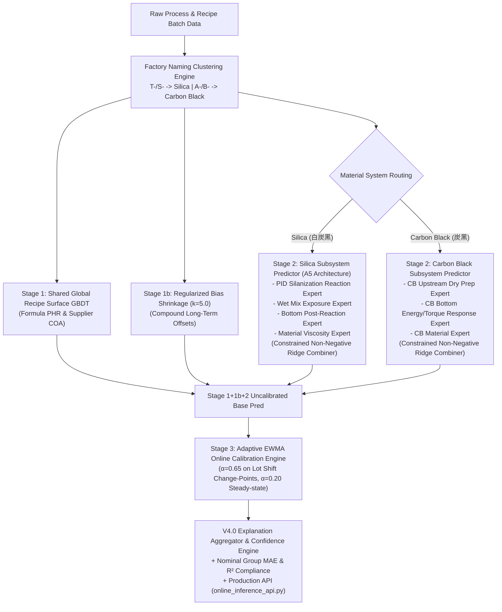

# 橡胶混炼门尼粘度预测与在线校准系统 (Mooney Viscosity Prediction & Calibration Pipeline V3.7 / V3.8 / V4.0)

本项目基于**工业大数据与流变物理机理知识库**，构建了工业级橡胶密炼过程成品门尼粘度（MNY）的**四阶段混合统一预测与在线延迟校准管道 (V3.7 Hybrid Unified & Stage 3 EWMA Online Calibration Pipeline)**。

攻克了传统纯数据驱动模型对配方“静态记忆过拟合”、无法捕捉“车次间动态工艺波动 (batch-to-batch fluctuations)”、“方差坍缩 (Variance Collapse)”以及“趋势倒挂 (负相关)”等工业落地硬伤，并全面适配大陆集团（Continental AG）**名义组级工业评估标准 (Nominal Group MAE & Nominal R²)** 与 **V4.0 现场可信度体系**。

---

## 📁 核心项目结构 (Repository Architecture)

```text
Master batch data fectching/
│
├── 📁 Mooney_Prediction_Pipeline/             ──> 【V3.7 核心模型与算法管道】
│   │
│   ├── 📁 feature_engineering/                 ──> 【特征工程与物料分类引擎】
│   │   ├── clustering.py                       ──> [大陆工厂命名规范分类引擎] T-/S-前缀->Silica, A-/B-前缀->CarbonBlack
│   │   ├── silica_pid_feature_builder.py       ──> [PID 偶联反应/热暴露 Proxy 特征抽取器]
│   │   ├── cb_dispersion_feature_builder.py    ──> [炭黑 Dispersion Work Proxy 特征抽取器 (CB_V1 基线)]
│   │   ├── cb_dispersion_feature_builder_v21.py──> [炭黑 V2.1 精简实验特征库 (Experimental Candidate)]
│   │   ├── stage1_recipe_features.py           ──> [Stage 1 配方特征抽取]
│   │   └── stage2_process_features.py           ──> [Stage 2 混炼过程残差特征抽取]
│   │
│   ├── 📁 model_training/                      ──> 【四阶段解耦模型训练与评估引擎】
│   │   ├── hybrid_unified_model.py             ──> [V3.7 4-Stage 统一预测主架构]
│   │   ├── silica_subsystem.py                 ──> [白炭黑 PID/Wet/Bottom/Material 4-Expert 非负 Ridge 体系]
│   │   ├── cb_subsystem.py                     ──> [炭黑 3-Expert 非负 Ridge 解耦残差体系]
│   │   ├── stage3_online_calibration.py        ──> [Stage 3 EWMA 延迟反馈在线校准引擎 (α=0.65 变点追赶)]
│   │   ├── bias_shrinkage.py                   ──> [Stage 1b Regularized Compound Bias Shrinkage (k=5.0)]
│   │   ├── split_builder.py                    ──> [零泄漏 100% Leak-Free 配方/标签组切分器]
│   │   ├── trend_metrics.py                    ──> [方差比 Ratio / 描述方向准确率 DirAcc / Spearman 评价指标]
│   │   ├── run_nominal_group_performance_audit.py ──> [名义组级聚合评估与 Raw Batch 对比审计]
│   │   ├── fetch_4_batches_predictions.py       ──> [特定车次 3 阶段预测分解诊断器]
│   │   └── predict_order_2325066_series.py     ──> [全订单时间序列预测与 EWMA 收敛诊断]
│   │
│   ├── 📁 models/                              ──> 【生产在线部署包 (Production Package)】
│   │   └── 📁 v37_production_model_package/    ──> [已导出的二进制模型包、特征元数据与 online_inference_api.py]
│   │       ├── hybrid_model.joblib             ──> Stage 1 + 1b + Stage 2 主模型权重
│   │       ├── stage3_calibrator.joblib        ──> Stage 3 EWMA 状态机
│   │       ├── feature_metadata.json           ──> 特征字段 Schema 元数据
│   │       └── online_inference_api.py         ──> [生产环境秒级在线推理 API 入口]
│   │
│   └── 📁 dashboard/                           ──> 【MMS 真实生产实时可解释性 Web 看板】
│       ├── index.html                          ──> [暗黑深色玻璃拟态可视化交互界面 (Chart.js)]
│       └── serve_dashboard.py                  ──> [提供 /api/real_batches 接口的 REST HTTP 服务器]
│
├── 📁 docs/                                   ──> 【上线后闭环优化与实施方案】
│   └── production_online_calibration_and_continuous_improvement_plan.md ──> [V1.0/V4.0 闭环实施计划全书]
│
├── 📁 reports/                                 ──> 【各维度验证实验与审计报告 CSV】
│   ├── v37_nominal_audit/                      ──> 名义组级评估报告与数据表
│   ├── v37_silica_audit/                       ──> 白炭黑全量及 Best/Worst 10 胶料审计表
│   └── v37_cb_dispersion_v21/                  ──> 炭黑 V2.1 B0-B4 消融对比与决策表
│
└── pipeline_orchestrator.py                    ──> 【全流程调度执行入口】
```

---

## 1. 核心 V3.7 四阶段解耦架构 (V3.7 4-Stage Architecture)

$$\text{Final Pred}(t) = \underbrace{f_{\text{GBDT}}(X_{S1})}_{\text{Stage 1 全局配方表面}} + \underbrace{\hat{b}_{c}}_{\text{Stage 1b Regularized Bias}} + \underbrace{E_{\text{Material-Route}}(\Delta X_{S2})}_{\mathbf{Stage 2\text{ 解耦残差专家 (A5 架构)}}}+ \underbrace{\text{EWMA}(e_{t-k}, \alpha_t)}_{\mathbf{Stage 3\text{ 在线延迟校准}}}$$



---

## 2. 名义组级工业评估与最新实测指标 (Nominal Group Metrics)

在 1,367 批次零泄漏测试集中，对应 **461 个独立的 Lab 采样组（OrderID + PalletID）**。最新的名义组级评估结果如下：

| 胶料体系 (Material System) | 测试车数 ($N$) | 独立 Lab 采样组数 ($K$) | 逐车混淆 MAE | **名义组级 MAE (Nominal Group MAE)** | 逐车混淆 $R^2$ | **名义组级 $R^2$ (Nominal Group $R^2$)** | **有效组方向准确率 (Valid DirAcc)** |
| :--- | :---: | :---: | :---: | :---: | :---: | :---: | :---: |
| **白炭黑体系 (Silica)** | 1,209 车 | 403 组 | 2.6593 MNY | **2.9037 MNY** | 0.8948 | **0.8911 (89.11%)** | **73.71%** |
| **炭黑体系 (CarbonBlack)**| 158 车 | 58 组 | 2.4365 MNY | **2.4733 MNY** | 0.9063 | **0.9007 (90.07%)** | **61.59%** |
| **全体系合计 (Overall All)**| **1,367 车** | **461 组** | **2.6335 MNY** | **2.8495 MNY** | **0.9043** | **0.9005 (90.05%)** | **71.85%** |

---

## 3. 生产部署与在线推理 API 使用指南 (Production API Usage)

模型已全量序列化打包至 `Mooney_Prediction_Pipeline/models/v37_production_model_package/` 目录。在生产上线时，只需使用 [online_inference_api.py](file:///c:/Users/uif35346/OneDrive%20-%20Continental%20AG/Desktop/Compound%20property%20prediction/Master%20batch%20data%20fectching/Mooney_Prediction_Pipeline/models/v37_production_model_package/online_inference_api.py) 模块：

```python
from Mooney_Prediction_Pipeline.models.v37_production_model_package.online_inference_api import MooneyPredictionService

# 1. 初始化生产服务
service = MooneyPredictionService()

# 2. 传入 PLC/MES 实时数据点进行毫秒级预测
result_df = service.predict_batch(realtime_plc_df)

# 3. 获取输出
print(result_df[['OrderID', 'BatchNumber', 'stage1_recipe_baseline', 'stage2_process_delta', 'predicted_mooney_viscosity']])
```

---

## 4. 上线后闭环优化与实施计划 (Continuous Improvement Plan)

关于上线后如何异步接收实验室 LIMS/SAP QM 反馈、触发 Stage 3 在线 EWMA 动态补偿与漂移监控的完整实施方案，请参阅专用文档：

📄 **[上线后延迟实验室反馈闭环优化实施计划 (docs/production_online_calibration_and_continuous_improvement_plan.md)](file:///c:/Users/uif35346/OneDrive%20-%20Continental%20AG/Desktop/Compound%20property%20prediction/Master%20batch%20data%20fectching/docs/production_online_calibration_and_continuous_improvement_plan.md)**

---

## 5. 全厂胶料能耗潜力排行与分步工艺优化模块 (Compound Energy Optimizer)

2026年10月新增独立模块 [`compound_energy_optimizer.py`](file:///c:/Users/uif35346/OneDrive%20-%20Continental%20AG/Desktop/Compound%20property%20prediction/Master%20batch%20data%20fectching/compound_energy_optimizer.py)，用于解决全厂密炼机能耗批次间离散、定位“车次能耗悬殊度最大且产量最高”的节能高潜胶料，并基于 47.1 万行实际分步遥测（Step Telemetry）自动求解调整步号与参数幅度。

### 5.1 核心功能与使用方法

```powershell
# 1. 全厂胶料节能潜力自动排行（纯炭黑 Top 5 与白炭黑 Top 5，输出年化可回收节电 MWh/yr）
python compound_energy_optimizer.py --mode rank --top 5

# 2. 针对指定胶料自动执行分步遥测方差归因与 DOE 推荐（含计算依据）
python compound_energy_optimizer.py --mode diagnose --compounds "M1-B00458---- 12 012" "M1-B00163---- 08 010"

# 3. 全流程一键批处理（排行 + 分步诊断 + 导出 CSV 汇总表与高清诊断看板）
python compound_energy_optimizer.py --mode all --top 5
```

### 5.2 核心输入输出资产与白炭黑专属 PID 总体时长 Hard Rule 门禁
- **白炭黑专属 PID 总体时长（`MST + MSB`）Hard Rule 刚性门禁（仅对白炭黑 `M1-T*` 生效，炭黑胶料豁免）**：
  - **Target 165°C**：总体 PID 时长必须处于 **`80 – 140 s`**
  - **Target 155°C**：总体 PID 时长必须处于 **`130 – 230 s`**
  - **Target 142°C**：总体 PID 时长必须处于 **`270 – 330 s`**
  - 炭黑胶料（`M1-B*`、`M1-R*`、`M1-A*`）无硅烷化反应，标记为 `EXEMPT`，全额执行 `MST` 高剪切步降速与 `MSB` 固定时间步缩减。
- **工程报告全书**：`reports/compound_energy_optimization_auto/Top5_CarbonBlack_and_Silica_Energy_Optimization_Report.md` 与 `docs/Top5_CarbonBlack_and_Silica_Energy_Optimization_Report.md`
- **全厂排行表**：`reports/compound_energy_optimization_auto/plant_wide_energy_potential_ranking.csv`
- **分步优化与 Hard Rule 审计表**：`reports/compound_energy_optimization_auto/top_compounds_step_diagnostics_summary.csv`
- **双联高清看板**：
  - `reports/compound_energy_optimization_auto/top5_cb_and_silica_energy_potential_dashboard.png`
  - `reports/compound_energy_optimization_auto/b00458_b00163_and_top_compounds_step_diagnosis.png`
- **分步遥测原始库**：`scratch/top_compounds_steps_raw.csv`（471,013 行真实分步参数）

### 5.3 Web 看板系统与 10.246.97.159 生产服务器部署 (Mixing Energy Dashboard)
- **生产访问入口**：`http://10.246.97.159:8888/`（直接在浏览器访问，顶部点击「**⚡ 胶料节能潜力与优化**」Tab）
- **核心功能**：
  1. **全厂胶料能耗潜力排行 (Energy Potential Ranking)**：全厂 33 款高产量胶料多维度排行，支持按「全部」、「炭黑 TOP 5」、「白炭黑 TOP 5」一键筛选与模糊搜索；
  2. **工步级遥测与方差贡献率 Wi 诊断 (Step-Level Diagnosis)**：查看任意胶料各工步设定与实测转速、功率、电耗及方差贡献率 $W_i$；
  3. **三大工艺优化处方建议**：MST 降速处方（-5 RPM）、MSB 降时处方（-9s）、白炭黑专属 PID 总体时长门禁（PASS/CLAMPED）及炭黑规则豁免（EXEMPT）；
  4. **全流程一键批处理重算**：支持前端一键执行动态多阶段批处理重算，并热更新前端数据；
  5. **高清四联看板放大预览**：集成嵌入 Top 5 潜力排行看板与重点胶料分步诊断看板，支持点击放大。
- **本地开发运行**：
  ```bash
  # 运行本地 Flask 测试看板 (Port 5000)
  python web_dashboard/app.py
  ```
- **服务器批处理重算脚本**：
  在服务器 `D:\HefeiEnergyDashboard_Release\run_server\` 目录下双击 `run_batch_optimization.bat`，即可一键重算并刷新全部数据资产。
